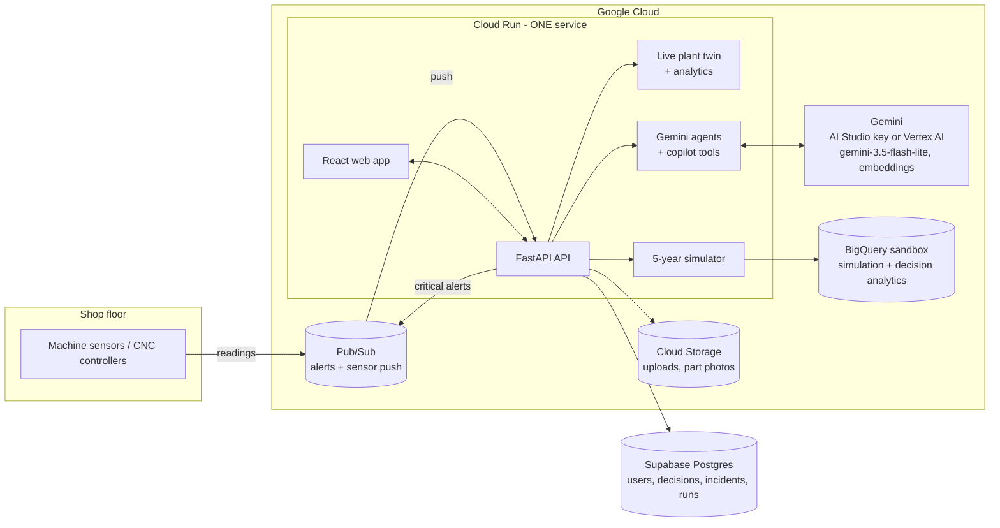

<p align="center"></p>

<h3 align="center">From machine signals to money-backed decisions</h3>
<p align="center">AI operations copilot for CNC and automotive-component plants · Team OpEx · AI Builder Cup 2026, Manufacturing track</p>

---

OpEx watches every machine on the shop floor, spots trouble early, works out the most likely cause, prices every way of dealing with it in rupees, and lets a person approve the best one. Every decision and its outcome is recorded, so the advice keeps improving. A built-in 5-year simulation shows what this is worth for a whole plant.

> **Detect → Diagnose → Decide (human approves) → Learn → Prove**

| Without OpEx | With OpEx |
|---|---|
| "Temperature is high." | "Vibration is 148% above its normal range and has risen steadily for 52 minutes. This pattern matched 7 past incidents; in 7, spindle bearing degradation was confirmed." |
| 50 alarms, no order | One ranked list: chance of failure × cost if it fails × how soon |
| "Machine will fail" | "Failure expected in 4–7 h (97%). Replace the bearing at the next shift change: ₹1.8 L protected, chance of failure >99% → 7%." |
| AI acts on its own | OpEx never touches a machine. An engineer approves, rejects or picks another option, and OpEx checks the outcome afterwards |

**Results from 5 simulated years (24 machines, calibrated on four real industrial datasets):** 74.5% fewer breakdowns, 10,012 machine-hours of breakdown avoided, net benefit **₹7.1 crore** after paying for OpEx, **12.1× ROI**, payback in **month 3**. All figures are labelled as simulated, and the calculations are in [§ 7](#7-the-5-year-simulation).

---

## Contents
1. [Features](#1-features)
2. [Who uses it: roles](#2-who-uses-it-roles)
3. [Architecture](#3-architecture)
4. [Folder structure](#4-folder-structure)
5. [Data and data processing](#5-data-and-data-processing)
6. [The AI: models and Gemini agents](#6-the-ai-models-and-gemini-agents)
7. [The 5-year simulation](#7-the-5-year-simulation)
8. [Database](#8-database)
9. [Design decisions and why](#9-design-decisions-and-why)
10. [Accessibility and inclusion](#10-accessibility-and-inclusion)
11. [Security and privacy](#11-security-and-privacy)
12. [Assumptions and sources](#12-assumptions-and-sources)
13. [Limitations and what's next](#13-limitations-and-whats-next)
14. [Running, keys, tests, deployment](#14-running-keys-tests-deployment)

---

## 1. Features

The numbers in brackets refer to the sections of the original idea document.

**Every page**
- The top bar shows whether data is live ("Live · 4 s ago"). If the connection drops, it says so instead of quietly showing old numbers. A **Pause** button stops live updates while you read.
- Jargon (OEE, chance of failure, failure window, confidence, data health) has a **?** next to it that explains the word in plain language.

**Overview: factory health (1)**
- A short **How to use OpEx** card on the first visit (dismiss it with *Got it*).
- **Shift briefing:** one click and Gemini writes the shift handover from live plant data, in your language, with read-aloud. It is cached for half a plant hour, so repeated clicks don't use up the free Gemini quota.
- Live view of all 24 machines on 4 lines. Shows plant OEE (availability × performance × quality), machines running, breakdown minutes this shift, defect rate, energy per good part and active anomalies.
- Five 0–100 health scores: machine, production, quality, energy and data.
- **"What should I worry about first?" (28):** issues ranked by probability × impact × urgency, which cuts alert fatigue. The top 3 are shown; the rest are one click away on the Actions page.
- Factory floor map. Normal machines stay grey; colour appears only when something is wrong, always with an icon and a word.
- Recent events, maintenance coming up, line OEE, and a technology tip chosen from the plant's actual problems.

**Machine page: Detect → Diagnose → Predict → Decide**
- A row of numbered links at the top jumps to each step, plus Photo check and Sensor history.
- **Anomaly detection (2)** in plain sentences: how far outside the normal range, and for how long it has been rising. Each reading has a small bar showing where it sits against its normal (green) band. The 3 most important are shown first.
- During a short stop such as a tool change, the forecast keeps using the machine's last minutes of cutting, so a failing part doesn't "disappear" for a few minutes.
- **Factory data health (27):** missing readings, noise, uncorroborated drift, staleness, calibration age and physically inconsistent readings (power vs current × voltage). Bad data visibly lowers confidence, e.g. "Confidence reduced from 84% to 67% because of these data problems."
- **Root cause (5) and chain of impact (6):** the signals are combined into one explanation, with abnormal signals ordered by when they started (Vibration ↑ → Defects ↑ → Energy/part ↑ → Cycle time ↑ → Temperature ↑).
  - A faulty sensor is diagnosed as a sensor fault, not a machine fault.
- **Factory memory (7):** "Have we seen this before?" compares today's sensor pattern with 194 past incidents and shows the technicians' notes.
- **Failure prediction (3):** probability of failure within 8 h, failure window (10–90%), confidence, and cost if it fails. Gives a remaining-life estimate for every component.
- **Quality prediction (15):** "defect probability will rise from 4.0% to 4.6% within 3 hours."
- **Energy (16):** energy per part against normal, and spindle and coolant left running while a machine is idle.
- **Interventions (8), economic impact (10) and side-by-side comparison (11):** the doc's 7 options (stop now, reduce speed 10%, continue to the maintenance window, shift production, partial maintenance, replace component, increase monitoring), plus tool change, standby and sensor recalibration.
  - Each option shows downtime, ₹ expected cost (maintenance + idle crew + lost production + scrap + energy, plus the chance it still breaks down), chance of failure, extra bad parts, energy per part, and how often it has worked in this plant.
  - The best 3 options are compared first; *Show all options* lists the rest.
- **Best action (12) and multi-objective engine (13):** presets are Balanced, Production first, Quality first, Energy saver and Safety first. One hard safety rule: never recommend keeping a likely breakdown running.
- **Human approval (30):** Approve, Reject, or choose another option, with a note. Permissions depend on role, and each option says which role may approve it.
  - Actions that stop, slow or open a machine ask once more, stating exactly what will happen (hours stopped, parts lost, cost, chance it still breaks down).
  - Afterwards the page confirms the decision and says when OpEx will check whether it worked (2 plant hours, about 12 real minutes at demo speed).
- **Photo check of a part:** take or upload a photo of a finished part (JPG, PNG or WEBP, up to 5 MB). Gemini looks for burrs, chatter marks, burns and cracks, links them to this machine's signals, and says *looks good*, *check it on the gauge* or *reject*. The photo is kept for traceability (Cloud Storage, or the local `storage/` folder).
- **AI incident room:** three Gemini agents (Diagnostician, Planner, Safety officer) review the case before you decide. See §6.
- **Maintenance planning (17) and spare parts (18):** what to inspect, which parts, how long the job takes, and whether it's an emergency or can wait for the Sunday window.
- Sensor history charts with the normal band shaded, plus a "show as table" version for screen readers.

**Actions page:** priority list, 3-week maintenance plan, spare parts to have ready, open alerts grouped by machine (worst first, top 3 shown, *Acknowledge all* per machine), and incidents with **AI-written investigations (21)**: what happened, when it started, what changed, root cause, impact, options, action taken, and whether it worked.

**Ask OpEx: natural-language copilot (19, 20)**
- Gemini answers by calling OpEx's own tools (live status, machine diagnosis, priced options, line performance, factory memory, simulation results), so numbers come from data, not the language model.
- It answers questions like "Why is Line 3 underperforming?", "What happens if I shut down Machine 17?", "How do I inspect this bearing?" (from the SOPs) and "Prioritise production over energy for M-17".
- **Voice input** (speak the question), **read-aloud answers**, and **six languages**: English, Hindi, Telugu, Tamil, Kannada, Marathi.
- **Photo check:** attach a picture of a part and Gemini describes visible defects and likely machine causes.

**Learning log: closed-loop learning (25), before/after (24), confidence (26)**
- Records prediction → recommendation → human decision → actual outcome, checked again 2 plant hours later.
- Success counts per problem and action, e.g. "worked 9 of 11 times", feed straight back into how options are ranked.
- Shows before/after OEE, vibration and defects for each decision, and how often people follow the AI.

**5-year simulation (22, 23):** see §7.
- Choose how long the replay takes (20 s to 10 min) and how many years to simulate.
- Live side-by-side counters, two factory floors, charts and an event ticker.
- Results, a check against published benchmarks, "How we calculated this", **Rewind the factory** (replay a real breakdown with OpEx watching), and CSV/JSON downloads.

**Data & models:** pipeline, every dataset with its cleaning steps, model scorecards on held-out data, every simulator input with its source, an upload checker for your own sensor CSV, and a factory-memory library you can search and add to.
- **Send to BigQuery** (plant manager): one click copies the decisions, incidents, alerts and latest simulation into BigQuery tables, ready for Looker Studio. Works in the free BigQuery sandbox.

**Alerts and notifications (29):** one alert per machine and problem, which clears itself. New critical alerts pop up on screen and are announced to screen readers. A pop-up stays until you dismiss it (no time limit to read it) and has a button to open that machine. Alerts can also be pushed to **Pub/Sub** for SMS, WhatsApp or ticketing.

**Settings:** accessibility, plant priorities, factory economics (₹ assumptions), people and roles, demo controls (resetting the plant asks for confirmation first), audit log.

## 2. Who uses it: roles

| Role | Typical person | Can do |
|---|---|---|
| **Plant manager** | Plant head, operations manager | Everything an engineer can do, plus priorities, factory economics, demo controls, audit log, BigQuery export, and adds managers and engineers |
| **Maintenance engineer** | Maintenance in-charge, shift engineer | Approve, reject or modify any recommendation (stops, part swaps, speed changes); acknowledge alerts; write investigations; add SOPs; ask the copilot |

The full explanation of every role, what it can and cannot do, and why, is in [ROLES.md](ROLES.md). Permissions are enforced on the server (`backend/app/auth/security.py`), not just hidden in the UI. Every decision and setting change goes to the `audit_log` table.

**Signing in.** Everyone signs in with **Google** (single sign-on); OpEx stores no passwords for real people. A person can sign in once a manager has added their Google email; any other Google account is turned away. The first manager account is created automatically from `MASTER_ADMIN_EMAIL` and cannot be demoted or switched off through the app. Setup: [AUDIT.md step 2b](AUDIT.md).

**Demo accounts** (only when `DEMO_MODE=true`, and the only accounts that use a password) all use the password `OpEx-demo-2026`:
- `manager@opex.demo`
- `engineer@opex.demo`

On the sign-in page you pick one of these accounts from a list and click **Log in**; there is nothing to type.

## 3. Architecture



**One deployable unit.** A single Docker image runs on a single Cloud Run service. It serves the web app, the API, the live plant twin, the analytics, the simulator and the Gemini agents. Supabase is a managed database, not a second thing to host.

How one machine is assessed (`backend/app/analytics/machine_report.py`, cached per plant minute) and turned into a decision (`backend/app/decisions/`):

```
readings (last 4 h, cutting minutes only; during a short stop, the last cutting minutes)
  ├─ data health ──────────────► confidence multiplier
  ├─ anomaly detection ────────► sentences + chain of impact
  ├─ health estimators ────────► damage per component ─┬─► trend RUL (live fit, life-fraction space)
  │                                                      └─► C-MAPSS RUL model (slow wear)
  ├─ AI4I classifier ──────────► operating-point risk (overstrain, power, heat)
  ├─ fault signatures + memory ► root cause + "seen this before"
  └─ physics model ────────────► quality, energy, ₹/hour impact
                      ▼
priced options (decisions/options.py) → multi-objective ranking (decisions/ranking.py)
  → recommendation → Gemini incident room → human decision (decisions/service.py)
                      ▼
outcome check after 2 plant hours → success counts (decisions/learning.py) → next ranking
```

The whole plant view (`analytics/factory_report.py`) batches the slow model calls for all 24 machines into one call per model.

The analytics are deterministic and fast (a full 24-machine overview takes about 0.2 s). Gemini explains, reasons over the evidence and converses, but it never makes up a number.

## 4. Folder structure

```
.
├── README.md, HOW_TO_RUN.md, AUDIT.md, ROLES.md ← start here
├── .env.example / .env                  ← settings and keys (AUDIT.md explains each)
├── Dockerfile, docker-compose.yml       ← one container: Docker Desktop, Render or Cloud Run
├── database/                            ← SQL to run in Supabase
│   ├── 01_schema.sql                    ← all tables
│   ├── 02_security.sql                  ← lock tables away from Supabase's public API
│   └── 03_reporting_views.sql           ← optional reporting views
├── backend/                             ← Python: API + AI + simulation
│   ├── app/
│   │   ├── main.py                      ← starts everything, serves the web app
│   │   ├── core/                        ← settings, logging, paths
│   │   ├── auth/                        ← sign-in, roles, permissions
│   │   ├── db/                          ← tables, connection, first-run data
│   │   ├── plant/                       ← the factory: machines, ₹ assumptions, physics, live twin
│   │   ├── analytics/                   ← anomalies, data health, prediction, root cause,
│   │   │                                   one machine's report, the whole plant's report
│   │   ├── decisions/                   ← price options, rank them, record decisions, learn from outcomes
│   │   ├── simulation/                  ← 5-year engine, report, rewind
│   │   ├── ai/                          ← Gemini client, incident-room agents, copilot, photo check
│   │   ├── knowledge/                   ← factory-memory search
│   │   ├── services/                    ← alerts, saved plant settings
│   │   ├── integrations/                ← BigQuery, Cloud Storage, Pub/Sub (all optional)
│   │   └── api/                         ← HTTP routes
│   ├── pipeline/                        ← data processing + model training (offline)
│   └── tests/
├── frontend/                            ← React + TypeScript web app (built copy in dist/)
│   └── src/
│       ├── components/                  ← layout, shared UI pieces (cards, badges, dialogs, glossary terms)
│       ├── lib/                         ← API calls, shared queries, response types, plain-language glossary
│       └── pages/                       ← one file per page; machine/ and simulation/ split into one file per step
├── data/
│   ├── raw/                             ← the public datasets
│   ├── processed/                       ← cleaned data, calibration, factory memory (generated)
│   └── knowledge/                       ← SOPs and manual excerpts
├── models/                              ← trained models + their test scores (generated)
└── pitch/                               ← pitch deck, screenshots, numbers
```

## 5. Data and data processing

Four public industrial datasets. Each is used for the thing it is actually good at.

| Dataset | What it is | What OpEx uses it for | Licence |
|---|---|---|---|
| **AI4I 2020** (UCI #601) | 10,000 machining records: temperatures, speed, torque, tool wear, 5 failure modes | Failure-mode classifier (operating-point risk); tool-wear limits | CC BY 4.0 |
| **NASA C-MAPSS FD001** | 100 engines run to failure, 21 sensors | Shape of degradation over life, spread of lifetimes, remaining-life model and its error | NASA open data |
| **Microsoft Azure PdM** | 100 machines × 8,760 h of telemetry, 761 labelled component failures, 3,286 maintenance jobs | Which sensor shows which failure (fault signatures), failure rates, detection and false-alarm rates, maintenance history | Microsoft sample (attribution) |
| **Zenodo 17855209** | A real serial production line: 62 shifts of OEE, 635 stop events | Loss structure (minor stops, set-ups, repair-time spread), baseline performance and quality | CC BY 4.0 |
| **NIST Nestor** vocabulary | Maintenance work-order tagging vocabulary | Tags technician notes as Item / Problem / Solution | Public domain |

**Pipeline** (`backend/pipeline/`, run with `python -m pipeline.run_all`, about 30 s):

1. `download_data.py` fetches the datasets (they also ship in `data/raw`, except the 79 MB Azure telemetry file).
2. `prepare_datasets.py` cleans them and writes `data_quality_report.json`:
   - Kelvin to Celsius; derived power and wear × torque.
   - Repairs AI4I's inconsistent failure labels.
   - Drops constant C-MAPSS channels and labels remaining life.
   - Removes duplicate telemetry hours.
   - Parses and normalises the Zenodo stops.
3. `train_failure_model.py`, `train_rul_model.py`, `train_precursor_model.py` train the three models (§6).
4. `calibrate_simulation.py` turns dataset statistics into simulator inputs. Each input is stored with its value, source and method, and the app displays them.
5. `build_factory_memory.py` replays real Azure PdM maintenance dates for machines 1–24 onto M-01…M-24 (re-dated by +3,926 days). It adds technician notes in work-order shorthand and tags them the NIST Nestor way, producing 793 jobs and 194 past incidents with their sensor patterns.

**Live data path.** In production, readings come from a gateway or Pub/Sub push to `POST /api/ingest/readings` (protected by `INGEST_API_KEY`) and override the twin for that machine.

**Upload checker.** On the Data page you can upload any sensor CSV. OpEx parses timestamps, removes impossible spikes (more than 8 robust SDs), resamples to 1 minute, scores data health and checks it against the chosen machine's normal ranges. A template is provided.

## 6. The AI: models and Gemini agents

### Machine-learning models (scores on data they never saw)

| Model | Data | Result |
|---|---|---|
| Failure-mode classifier (gradient boosting, 5 classes) | AI4I 2020, stratified 80/20 | **ROC AUC 0.996**, PR AUC 0.950, precision 94% / recall 89%, correct failure mode 97%. Tool-wear failures are near-random in AI4I (11% caught); we say so, and OpEx watches tool wear directly |
| Remaining-life model (gradient boosting + 10%/90% quantile models on health-index features) | NASA C-MAPSS FD001, NASA's 100 test engines | **RMSE 13.0 cycles**, NASA score 300, 10–90% band covers 82% of engines, 100% warned at least 10 cycles ahead |
| Component precursor model (48 h horizon) | Azure PdM, trained Jan–Aug, tested Sep–Dec | Caught 94–100% of component failures 24–32 h ahead; 1.2–5.8 false alarms per machine-year. Azure PdM is synthetic, so the simulator discounts these rates |

**Why a health index?** Jet engines are not spindles. The remaining-life model only sees health-index features (current health, slope, age as a fraction of mean life), so it transfers to any machine that can produce a health index. Physics-informed estimators turn each machine's vibration, speed, coolant pressure and voltage into component damage. These are the same four failure signatures the Azure data revealed: bearing → vibration (+1.84 σ), drive → speed (−1.49 σ), coolant → pressure (+2.17 σ), electrical → voltage (+1.30 σ).

**Live remaining life.** Two estimators run on each component, and the more cautious one wins:
- **Trend:** damage is mapped back to life fraction using the C-MAPSS curve, where it grows linearly under constant stress. A fit over 4 hours gives time-to-failure with an error band.
- **Model:** the C-MAPSS model above, for slow wear.

Warnings are "sticky" for 45 plant minutes so they don't flicker (ISA-18.2 alarm practice).

### Gemini, used where language and reasoning help

All calls go through `google-genai`, with either a free Google AI Studio API key or Vertex AI. Default model for everything: `gemini-3.5-flash-lite`, because its free tier allows far more requests per day than `gemini-3.8-flash` (you can switch with `GEMINI_MODEL`). Embeddings: `gemini-embedding-001` at 768 dimensions.

1. **AI incident room (multi-agent)** (`backend/app/ai/agents.py`). Each agent has one job:
   - **Diagnostician:** weighs the anomalies, cause candidates, matching past incidents, technicians' notes and data-quality doubts. Returns the root cause, evidence for and against, and what to check first.
   - **Planner:** explains the priced options and the trade-off in manager language, including what happens if nobody acts.
   - **Safety officer:** retrieves the relevant SOPs (Lockout-Tagout, spindle bearing, and so on) and lists what must happen before anyone starts, with SOP references. It cannot invent procedures.

   Agents receive only facts OpEx has already computed. Output is structured JSON. The trace is saved with the recommendation, so it can be audited.
2. **Copilot with function calling** (`backend/app/ai/copilot.py`). Gemini picks from 6 tools: factory status, machine diagnosis, priced options under any priority, factory-memory search, line performance and simulation results. It also handles photos of parts and answers in six languages.
3. **Investigation writer.** Turns an incident's recorded evidence and decisions into an 8-section report.
4. **Shift briefing.** Writes the handover note a supervisor writes by hand today, from the live overview. Cached per language for half a plant hour.
5. **Photo check** (`backend/app/ai/vision.py`). Looks at a photo of a finished part together with the machine's live diagnosis and returns structured JSON: verdict, visible defects, likely machine cause and next steps.
6. **Semantic factory memory.** Hybrid retrieval: keyword (TF-IDF) plus Gemini embeddings.

**No Gemini key? Everything still works.** Each agent has a rule-based fallback and the copilot has an intent router. The UI labels which answers are Gemini and which are rule-based.

## 7. The 5-year simulation

`backend/app/simulation/engine.py` simulates the same 24-machine plant twice, hour by hour, for up to 5 years (2.1 million machine-hours in about 4.5 s):

- **Without AI:** today's reactive plant. Time-based PM on Sundays; components run until they fail.
- **With OpEx:** precursor warnings, planned swaps in the Sunday window (or at the next shift change if the part won't last), 10% speed reduction to stretch life until the window, and auto-standby for idle machines.

**Both worlds share every random draw:** component lives, repair times, stock-outs, secondary damage and minor stops. Every difference therefore comes from the decisions. Detection is not assumed to be perfect:

```
P(failure prevented) = model recall (Azure PdM, held-out) × sensor coverage (90%) × people following the advice (85%)
                     = 1.00 × 0.90 × 0.85 = 76% for bearings
warning time         = parts lead time ÷ (1 + error),  error ~ N(0.036, 0.204) measured on NASA C-MAPSS
false alarms         = 11.9 per machine-year (Azure PdM held-out) → 1 h inspection stop each when acted on
```

**Inputs and where they come from:**

| Input | Value | Source |
|---|---|---|
| Component failures per machine-year | bearing 1.79, drive 2.59, electrical 1.92, coolant 1.31 | Azure PdM failures ÷ 100 machines |
| Life spread (Weibull shape) | 4.41 | NASA C-MAPSS lifetimes |
| Degradation curve | damage = (e^(3.75u) − 1)/(e^3.75 − 1) | NASA C-MAPSS health index |
| Repair-time spread | lognormal σ = 0.82 | Zenodo line failure stops |
| Minor stops, set-ups, changeovers | 8.9% + 8.6% of planned time (same in both worlds) | Zenodo line |
| Base performance / quality | 92.9% / 98.3% | Zenodo line |
| Planned production | 3 shifts × 7.5 h, 6 days, 12 holidays = 6,750 h/year | Plant calendar |
| Repair hours (planned / breakdown) | bearing 6/14, drive 4/8, electrical 2/5, coolant 2/4 | Engineering estimates |
| Stock-out and secondary damage | bearing: 35% wait 36 h; 40% chance of ₹2.2 L spindle damage | Engineering estimates (BHEL tender: spindle bearing job ₹2.88 L) |
| Electricity | ₹9.25/kWh | MSEDCL HT-I(A) FY27 energy + wheeling (MERC order, Mar 2026) |
| Grid emissions | 0.675 t CO₂/MWh | CEA CO₂ Baseline Database v22 (FY2025-26) |
| Maintenance labour | ₹300/h (×1.5 overtime after breakdowns) | In-house technician (Indeed India 2026) blended with OEM service visits |
| Contribution margin per part | ₹175–760 (₹4,200–6,500 per machine-hour) | Product price minus variable cost (see `factory.py`) |
| Cost of OpEx | ₹45k sensor kit × 24 + ₹6 L setup, then ₹2.4 L cloud + ₹6 L support per year | Estimate |

**Result** (default settings, seed 2026). These are simulated results calibrated on real data, not a real factory's results:

| | Without AI | With OpEx | Change |
|---|---|---|---|
| Breakdowns | 893 | 228 | **−74.5%** (US DOE: 70–75%) |
| Breakdown hours | 13,207 | 3,195 (+1,698 planned) | −10,012 h |
| Maintenance cost | ₹8.55 Cr | ₹6.32 Cr | **−26%** (US DOE: 25–30%) |
| Secondary damage | ₹2.57 Cr | ₹0.53 Cr | −79% |
| OEE | 71.7% | 72.6% | +1.0 pt |
| Good parts | 1.022 Cr | 1.036 Cr | +1,40,944 |
| Energy | 10,189 MWh | 9,682 MWh | −507 MWh, −342 t CO₂ |

**Benefit:** production ₹4.45 Cr + maintenance ₹2.22 Cr + scrap ₹0.55 Cr + energy ₹0.47 Cr = **₹7.69 Cr**.

**Net:** ₹7.69 Cr − ₹0.59 Cr (cost of OpEx) = **₹7.11 Cr**, so **ROI = 7.11 ÷ 0.59 = 12.1×**. Payback comes in **month 3**.

The OEE gain is modest on purpose. Material shortages and set-ups (17.5% of planned time) are identical in both worlds, because predictive maintenance does not fix them. OpEx's value shows up as fewer breakdowns, less secondary damage and less scrap.

**Rewind the factory** takes one of the costliest breakdowns from the "without" history and replays that exact degradation with OpEx watching. Because the random draws are shared, it is the same bearing and the same luck. If OpEx would have missed it, the page says so.

## 8. Database

**Supabase Postgres in production, a local SQLite file for zero-setup runs.** Both use the same code (SQLAlchemy). The tables:

| Table | Holds | Why it exists |
|---|---|---|
| `app_users` | email, name, role, accessibility preferences (a password hash only for demo accounts) | Sign-in, roles, per-person display settings |
| `alerts` | one open alert per machine + kind | No alarm floods; auto-resolve |
| `incidents` | critical risks and breakdowns + JSON snapshot of what the AI saw + report | Investigations and audit |
| `recommendations` | priced options, weights, chosen action, agent trace | Explainability of every suggestion |
| `decisions` | human decision, note, before/after, outcome | Closed-loop learning, AI-agreement stats |
| `knowledge_documents` | SOPs and notes people add | Factory memory grows over time |
| `simulation_runs` | parameters, results, replay data, events | Re-open and download any run |
| `audit_log` | who did what, when | Traceability |
| `app_settings` | priorities, economics | Plant-wide settings without redeploying |

The SQL scripts are in `database/`. If the tables are missing, the app runs them automatically on first start. Row Level Security is switched on with no policies, so Supabase's public REST API (anon key) cannot read anything. Only the backend's direct connection can (§11).

## 9. Design decisions and why

| Decision | Why |
|---|---|
| **One container (FastAPI serves the React build)** | One thing to host on one Cloud Run service. No CORS in production, one URL, and simple to deploy and judge |
| **Deterministic analytics, LLM for reasoning and language** | Numbers must be reproducible and auditable. Gemini explains, weighs evidence, converses and writes, using only computed facts |
| **Physics-informed health index + transferable RUL model** | No public 5-year CNC run-to-failure data exists. We transfer what really transfers (degradation shape, error spread) and say so |
| **Shared random draws in the simulator** | Makes with-vs-without a fair counterfactual and enables "Rewind the factory" |
| **Realistic, not flattering, assumptions** | Model misses, false alarms, people not following advice, stock-outs and minor stops are all included, and results land inside published US DOE ranges |
| **Google sign-in (free) + our own session cookie instead of Supabase Auth** | People use the account they already have. OpEx verifies Google's signed token on the server, then issues its own httpOnly cookie, so it works the same on Supabase and offline SQLite and roles are enforced server-side |
| **In-memory hybrid search instead of pgvector** | The corpus is about 250 chunks; numpy answers in milliseconds. Move to pgvector at about 100k chunks |
| **Free Gemini API key by default, Vertex AI when you scale** | An AI Studio key costs nothing and takes 2 minutes. Vertex AI (no free tier) adds data residency, IAM and higher quotas for production |
| **`gemini-3.5-flash-lite` as the default model** | Its free tier allows many more requests per day than `gemini-3.8-flash`. OpEx gives Gemini computed facts, so a lighter model is enough |
| **BigQuery, Cloud Storage, Pub/Sub optional** | They are used where they add value (analytics, file and photo storage, event fan-out) but never block a local run. Each fits in its free tier at demo scale (AUDIT.md lists the limits) |
| **Not used: Dataflow, Vertex AI training** | At 24 machines and 1-minute data, pandas and scikit-learn train in 30 s inside the container. Dataflow (Pub/Sub → BigQuery template) is the path once a plant streams more than about 10k readings/s |
| **Cloud Run `max-instances=1`** | The live plant twin lives in memory; one instance keeps a single consistent plant. Real deployments ingest real readings, and then you can scale out |
| **Accessibility first, ISA-101 style** | Neutral screens, colour only for abnormal states, icon + word + colour for every status |

## 10. Accessibility and inclusion

Built to WCAG 2.2 AA, with shop floors, older workers, low literacy and neurodivergent users in mind.

- **Never colour alone:** every status has an icon shape and a word ("Critical · Act now").
- **Fonts:** Atkinson Hyperlegible Next (Braille Institute, for low vision) by default; Lexend as a reading-friendly option.
- **Display settings:** three text sizes, wide letter/line spacing, dark mode, high-contrast mode, and reduced motion (also follows the device setting).
- **Simple words mode:** AI explanations at reading age 12. **Focus mode** hides secondary panels.
- **Read aloud** on summaries and answers; **voice input** for questions (gloves on, hands busy); **six Indian languages** for AI answers and voice.
- **Keyboard and screen readers:**
  - Skip link, focus moves on page change, visible 3 px focus ring, and 44 px touch targets for gloved fingers.
  - Live regions announce critical alerts and simulation progress, throttled so they don't flood.
  - Every chart has a text alternative and a "show as table" view.
- **Plain-language structure:** every page starts with one sentence saying what it's for. Machine pages follow numbered steps (1 What we detected, 2 Why, 3 What happens next, 4 What should we do?). Jargon has a **?** that explains it. One name per idea everywhere (always "chance of failure", never a mix of terms).
- **Time and control:** no timeouts; alert pop-ups stay until dismissed; live updates can be paused (WCAG 2.2.2). Actions that stop or slow a machine, and resetting the demo, ask for confirmation and say what will happen.
- **Less to take in at once:** long lists (signals, options, alerts) show the top 3 first, with the rest one click away. Loading pages show grey placeholders in the shape of the page, so nothing jumps.
- **Works on a phone or tablet at the machine.**

## 11. Security and privacy

- Sign-in is Google single sign-on: the server verifies Google's signed ID token (right app, not expired, email verified). Demo accounts use bcrypt-hashed passwords and exist only in demo mode. Sessions are signed JWTs in an httpOnly, SameSite=Lax cookie (Secure in production), valid for 12 h. Sign-in is rate-limited.
- Roles are checked on every request on the server. Only managers can manage people, priorities and costs; engineers approve and reject actions.
- The AI never actuates machines; a human decision is recorded for every action.
- Supabase tables have Row Level Security on and no public grants (`02_security.sql`). The database is reachable only through the backend.
- Secrets live in `.env` locally and in Cloud Run environment variables in production. `.env` is git-ignored, and keys are never sent to the browser.
- Uploads are size- and type-checked and saved under names OpEx generates (never the uploaded file name). The sensor-ingest endpoint needs an API key.
- No personal data beyond name and email is stored. Copilot conversations are not stored.
- On Gemini's free tier, Google may use prompts to improve its products. Use a paid key or Vertex AI for real plant data.

## 12. Assumptions and sources

All plant economics are in one file (`backend/app/plant/factory.py`), and a plant manager can change most of them from Settings → Factory economics.

**Sources**
- MSEDCL tariff order (MERC Case 75 of 2025, 25 Mar 2026)
- CEA CO₂ Baseline Database v22 (Aug 2026)
- US DOE/FEMP O&M Best Practices Guide Release 3.0 (2010), §5.4
- Siemens *True Cost of Downtime* 2024
- McKinsey (2017) predictive maintenance: downtime −30–50%
- Deloitte predictive maintenance position paper
- Terelak-Tymczyna et al., *Materials* 2024 (CNC idle power 50–60% of cutting)
- Gutowski et al., CIRP LCE 2006
- ISO 10816-3 vibration zones (heuristic for spindles)
- ACMA FY26 industry data (₹7.60 lakh crore turnover)
- Indeed India wage data (Oct 2026)
- BHEL spindle-repair tender (2020)

**The demo plant** "Sahyadri Precision Components, Unit 2" and its people are fictional.

## 13. Limitations and what's next

**Limitations**
- The live plant is a calibrated digital twin, not a real factory. Real deployments replace it machine by machine through the ingest endpoint.
- Health estimators would be re-fitted per machine during commissioning.
- AI4I, C-MAPSS and Azure PdM are partly synthetic benchmarks; we discount their detection rates and say so.

**Next**
- OPC UA / MTConnect connectors.
- Dataflow streaming into BigQuery.
- Per-machine model fine-tuning on Vertex AI once 6 months of plant data exist.
- Spare-parts auto-ordering.
- Vision inspection on the line camera (today's photo check is manual).

## 14. Running, keys, tests, deployment

- **Run it:** [HOW_TO_RUN.md](HOW_TO_RUN.md): Docker Desktop (`docker compose up --build`) or a few terminal lines.
- **Add keys** (Supabase, Gemini, Google Cloud): [AUDIT.md](AUDIT.md), step by step.
- **Developer mode:** `cd backend && ../.venv/bin/uvicorn app.main:app --reload`, plus `cd frontend && npm run dev` (http://localhost:5173).
- **Tests:** `cd backend && ../.venv/bin/python -m pytest -q` (38 tests, about 17 s). They cover every API route for every role (`tests/test_flows.py`), simulator determinism and benefit, the scripted live scenario, permissions, the decision flow, uploads, and the free fallbacks when no Gemini or Google Cloud keys are set.
- **Dev tools:** `.venv/bin/pip install -r backend/requirements-dev.txt` (tests and linting; the app itself needs only `requirements.txt`).
- **Code style:** `cd backend && ../.venv/bin/ruff check app tests pipeline` and `cd frontend && npx tsc --noEmit`.
- **Retrain:** `cd backend && ../.venv/bin/python -m pipeline.run_all`.
- **Deploy:** free on Render + Supabase, or Cloud Run: [AUDIT.md step 4](AUDIT.md). It is one Docker image either way.

Dataset credits:
- AI4I 2020 (S. Matzka, UCI)
- NASA C-MAPSS (Saxena et al., 2008)
- Microsoft Azure Predictive Maintenance sample
- Zenodo 17855209 (P. Ntoas, University of Cyprus, CC BY 4.0)
- NIST Nestor
